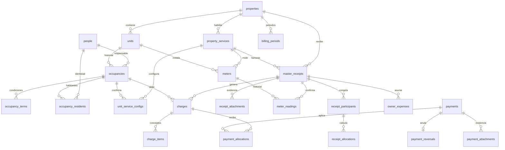

# Modelo SQLite

Migración inicial versionada en `src/core/database/migrations/001.ts`; versión declarada mediante `user_version` y `schema_migrations`. Una base nueva se crea transaccionalmente. Una versión futura debe agregar migraciones incrementales; una versión de esquema superior es rechazada sin borrar datos.

Se activa WAL y `foreign_keys=ON` por conexión. La conexión para escribir activa FK antes de comenzar su transacción. Identificadores UUID para nuevas entidades; los identificadores legibles de demostración están confinados a su base separada.

## Relaciones

`service_types` es el catálogo inicial. `property_services` incorpora los campos del servicio habilitado: no hay un catálogo personalizado global compartido que pueda modificar accidentalmente inmuebles distintos. `unit_service_configs` referencia una ocupación: evita reactivar servicios al cambiar de inquilino. `occupancy_terms` agrega cambios de renta/habitantes con fecha efectiva; los valores iniciales de `occupancies` siguen siendo el contrato inicial.

`charges` guarda nombres y códigos históricos. `charge_balances` calcula abonos y saldos excluyendo pagos revertidos; el estado se deriva de saldo y vencimiento en la capa de aplicación. `payment_reversals` conserva motivo y fecha sin modificar el pago original. `app_settings` guarda preferencias no secretas. SecureStore mantiene PIN derivado, sal e intentos fuera de SQLite. `audit_events` conserva acciones, fechas y motivos relevantes sin registros de diagnóstico de información sensible.

## Restricciones

- Código de unidad único por inmueble; documento único cuando no está vacío.
- Trigger de ocupaciones sin superposición, con intervalos inclusivos.
- Un medidor activo por unidad/servicio y coherencia de lecturas históricas.
- Recibo vigente único por inmueble, servicio y periodo; anular permite registrar una corrección nueva.
- `source_key` único para alquileres, fijos independientes y repartos.
- Asignaciones de pagos con identidad compatible, sin exceder pago ni deuda.
- Importes enteros no negativos; pagos estrictamente positivos.
- Triggers que impiden eliminar o modificar dinero confirmado, asignaciones, lecturas, gastos y auditoría. Solo se admite la anulación controlada de un cobro o recibo.
- Al finalizar, SQLite verifica que la factura coincida tanto con su reparto como con los cobros y gastos generados.

Fechas de negocio `YYYY-MM-DD`, periodos `YYYY-MM`, timestamps técnicos UTC ISO. Moneda: céntimos PEN. Lecturas y consumos: milésimas de kWh/m³. Índices por inmueble/periodo, documento, historial de medidor, ocupación y cobro aplicado. Las FK usan RESTRICT por defecto; no se borran personas o propiedades con historial.

Los adjuntos de pagos se guardan en `payment_attachments`. `receipt_attachments.meter_id` permite asociar una foto a un medidor. Los gastos independientes del propietario tienen `source_key` único y no generan una cuenta por cobrar. Los inmuebles archivados conservan su historial y rechazan nuevas unidades, ocupaciones, servicios y facturas.
